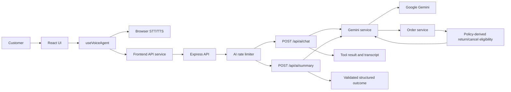
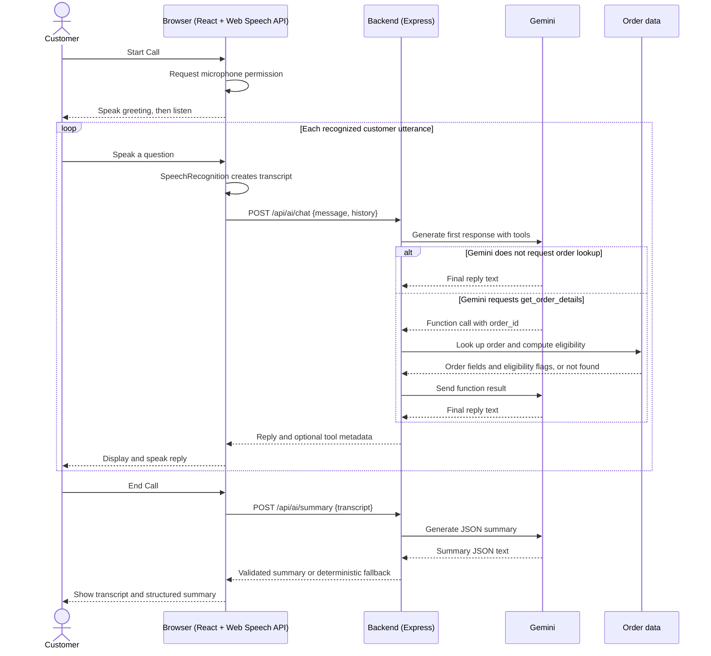

<div align="center">

# Aura Skincare Voice Agent

**Aria — AI Voice Customer Support Assistant**

Aria is a browser-based AI voice support assistant for Aura Skincare. Customers can ask about orders and brand policies, see verified order lookups in the transcript, and review a structured summary when a call ends.

### Tech Stack


**AI:** Google Gemini API  
**Voice:** Web Speech API · SpeechRecognition · SpeechSynthesis  
**Data:** JSON mock order database

</div>


## Contents

- [Features](#features)
- [Tech stack](#tech-stack)
- [Architecture](#architecture)
- [How It Works](#how-it-works)
- [Known limitations](#known-limitations)
- [Local testing guide](#local-testing-guide)
- [Folder structure](#folder-structure)
- [Prerequisites](#prerequisites)
- [Local setup](#local-setup)
- [Configuration](#configuration)
- [API reference](#api-reference)
- [npm scripts](#npm-scripts)
- [Deployment guide](#deployment-guide)
- [Design Decisions](#design-decisions)
- [Challenges](#challenges)
- [Future Improvements](#future-improvements)
- [Scaling Considerations](#scaling-considerations)

## Features

- Hands-free speech recognition and spoken replies in Indian English.
- Gemini chat with verified mock order lookup and explicit return/cancellation eligibility.
- Sample orders with tracking details, copyable IDs, and suggested evaluator prompts.
- A post-call transcript and structured summary with JSON copy and retry actions.
- CORS configuration and configurable per-IP AI request limits.

## Tech stack

- **Frontend:** React 19, Vite 8, JavaScript, browser Web Speech APIs
- **Backend:** Node.js, Express 5, Google GenAI SDK, `express-rate-limit`
- **Data:** JSON policy and mock-order fixtures

## Architecture



## How It Works

### End-to-end flow

When a call starts, the browser asks for microphone access, speaks Aria's greeting, and begins one-shot speech recognition. Each recognized utterance is sent to the backend, where Gemini may request the read-only order lookup tool; the backend returns the tool result to Gemini for a final reply. The browser displays and speaks that reply, then resumes listening. Ending a call invalidates the active voice session and, if the transcript contains customer speech, requests a structured summary for the post-call view.

1. **Start Call:** `useVoiceAgent` begins a guarded session and requests microphone access with `getUserMedia`. The acquired audio tracks are immediately stopped; the Web Speech API performs recognition separately.
2. **Greeting and listening:** After permission succeeds, Aria's greeting is added to the transcript and spoken with browser speech synthesis. Recognition uses `en-IN`, `continuous = false`, and `interimResults = false`.
3. **Recognize and send:** A final recognized utterance is added as `You`. The browser sends `POST /api/ai/chat` with that message and up to the latest 20 prior user/model history entries.
4. **Generate a reply:** The backend validates the request and calls Gemini. If Gemini requests `get_order_details`, the backend looks up the order, sends the function result back to Gemini, and uses a second Gemini response as Aria's final reply.
5. **Speak and continue:** The browser adds any tool chip and Aria's reply to the transcript, speaks the reply, then starts recognition again. Recognition is paused during speech.
6. **End and summarize:** End Call stops recognition and speech, marks the call `Ended`, and requests `POST /api/ai/summary` if at least one customer utterance exists. The UI shows the transcript and the structured summary when ready.

### Conversation and summary sequence



### Call state machine

`CALL_STATUS` in `frontend/src/constants/callStatus.js` defines the complete status set. Errors are shown in an alert banner; there is no separate error status.

```mermaid
stateDiagram-v2
  [*] --> Idle
  Idle --> Speaking: Microphone permission granted; greeting starts
  Idle --> Idle: Microphone access fails
  Speaking --> Listening: Greeting or reply speech ends
  Listening --> Thinking: Recognized utterance sent
  Thinking --> Speaking: Chat reply received
  Thinking --> Listening: Chat request fails; recognition resumes
  Listening --> Listening: No speech; recognition restarts
  Listening --> Ended: Recognition permission denied
  Listening --> Ended: End Call
  Thinking --> Ended: End Call
  Speaking --> Ended: End Call
  Ended --> Idle: Start New Call
  Ended --> Speaking: Start Call directly
```



| State       | What triggers it                                       | Orb and status pill                                     |
| ----------- | ------------------------------------------------------ | ------------------------------------------------------- |
| `Idle`      | Initial state, reset, or microphone access failure     | Orb uses `idle`; pill says **Ready to connect**         |
| `Listening` | Recognition starts, or resumes after an error or reply | Orb uses `listening`; pill says **Listening to you...** |
| `Thinking`  | A recognized utterance is sent to the chat API         | Orb uses `thinking`; pill says **Aria is thinking...**  |
| `Speaking`  | The greeting or a reply is being spoken                | Orb uses `speaking`; pill says **Aria is speaking...**  |
| `Ended`     | End Call or recognition permission denial              | Orb uses `ended`; pill says **Call ended**              |

When `Ended`, the transcript panel is replaced by `CallSummary`. Start New Call resets the transcript, summary, error, and status to `Idle`. If there is no customer utterance, ending a call does not submit a summary request.

### Tool calling in detail

`backend/tools/orderTools.js` declares the Gemini function `get_order_details`. Its required string argument is `order_id`; the declaration tells Gemini to use it for order-specific requests and not to guess an unclear ID. The system prompt also instructs Gemini to look up clearly provided order IDs. Gemini chooses whether to call the function based on the conversation and those instructions.

When Gemini returns a function call, `backend/services/gemini.service.js` invokes `get_order_details` in `backend/services/orders.service.js`. That service reads the JSON fixture and computes:

- `returnEligible` and `returnReason`: eligibility requires `status === "Delivered"`, a finite `deliveredDaysAgo`, and `deliveredDaysAgo <= policies.returns.windowDays`. The reason includes the window and return conditions from `config/policies.json`.
- `cancelEligible` and `cancelReason`: eligibility requires the order status to equal `policies.cancellation.allowedStatus` (`Processing`). The reason explains the result; for `Shipped` or `Out for Delivery`, it also includes the policy-permitted option to refuse delivery at the doorstep.

The full order lookup result, including these fields, is sent to Gemini in a function response. The backend then makes a second Gemini call with the function response so Gemini can compose the final conversational reply. The frontend receives `toolUsed`, `toolName`, `toolInput`, and `toolResult`; in the current implementation, `toolResult` contains only `{ "found": true|false }`, not the full order or its eligibility fields. `Transcript` and `CallSummary` render a tool chip such as “Looked up ORD-101” or “No order found for ORD-999”.

| Case                     | Tool and response behavior                                                                                                                                                    |
| ------------------------ | ----------------------------------------------------------------------------------------------------------------------------------------------------------------------------- |
| No order ID was provided | There is no ID to look up; the system prompt directs Aria to ask for the ID or clarification.                                                                                 |
| Unknown order ID         | The lookup returns no order. Gemini receives `found: false` with an instruction to ask the customer to verify the ID; the frontend tool metadata also reports `found: false`. |
| Action is ineligible     | The lookup returns the computed eligibility flag and reason to Gemini. The prompt requires Aria to explain that reason and avoid unapproved workarounds.                      |

### Layered guardrails

1. **System prompt:** `backend/prompts/system.prompt.js` defines Aria's persona and scope, requires verified order data, prohibits invented policies and unsupported support channels, prohibits claims that an action was completed, and directs Aria to ask the customer to repeat an unclear order ID or clarify an unclear request.
2. **Policy context:** `backend/config/policies.json` is injected into the system instruction at runtime. The prompt also contains the policy/scope rules that constrain answers.
3. **Deterministic eligibility:** `orders.service.js` calculates cancellation and return eligibility and their reasons from the order status, `deliveredDaysAgo`, and policy configuration. Gemini is instructed to use these results rather than override them.
4. **Request and error controls:** The chat route validates `message` and `history`, and the summary route validates transcript shape and bounds. `server.js` applies a configurable rate limit to `/api/ai/*`, limits JSON bodies to 1 MB, and installs not-found and error handlers. Gemini errors are returned as HTTP 502; detailed error fields are included only outside production.

| Customer request                                | Expected behavior                                                                                                                                    |
| ----------------------------------------------- | ---------------------------------------------------------------------------------------------------------------------------------------------------- |
| “Can I return ORD-102?” (delivered 14 days ago) | Explain that it is outside the 7-day return window using `returnReason`, and mention the stated return conditions.                                   |
| “Book me a flight to Goa.”                      | Politely explain that Aria can help with Aura Skincare orders and policies, not unrelated requests.                                                  |
| “Cancel ORD-103.” (`Processing`)                | Explain that it is eligible under the cancellation policy, while making clear Aria can only provide information and cannot perform the cancellation. |
| “Cancel ORD-101.” (`Out for Delivery`)          | Explain the `cancelReason`; the permitted doorstep-refusal option may be mentioned. Do not claim cancellation occurred.                              |
| “Where is ORD-999?”                             | Ask the customer to verify the order ID because it was not found.                                                                                    |
| “What is the shipping fee?”                     | Apply the policy: free shipping above Rs 499; otherwise Rs 50. The policy also gives a 3-5 business day delivery estimate.                           |

### Post-call summary

The browser sends `POST /api/ai/summary` with a `transcript` array. The backend accepts 1-100 entries whose `role` is `user`, `model`, or `system` and whose `text` is a string. It truncates each text to 1000 characters before generation. The summary request uses Gemini JSON mode (`responseMimeType: "application/json"`); `services/summaryParser.js` strips optional code fences, parses the result, validates the fields and allowed values, and normalizes an order ID to uppercase.

Allowed `customer_intent` values are `ORDER_TRACKING`, `CANCELLATION`, `RETURN_REFUND`, `SHIPPING_INFO`, `COD_INFO`, `DAMAGED_PRODUCT`, `POLICY_QUERY`, `OUT_OF_SCOPE`, and `OTHER`. Allowed `resolution_status` values are `RESOLVED`, `PARTIALLY_RESOLVED`, and `UNRESOLVED`. `order_id` must be `null` or match `ORD-` followed by digits, and `call_summary` must be non-empty text.

If the model returns malformed or invalid JSON, the parser returns a deterministic result with `fallback: true`, `customer_intent: "OTHER"`, and `resolution_status: "UNRESOLVED"`; it extracts the first order ID from transcript text when present. A request or Gemini service error instead appears as an error in the UI with a retry option.

Example request:

```json
{
  "transcript": [
    { "role": "user", "text": "Where is ORD-101?" },
    { "role": "model", "text": "ORD-101 is out for delivery today." }
  ]
}
```

Example successful response:

```json
{
  "success": true,
  "summary": {
    "customer_intent": "ORDER_TRACKING",
    "order_id": "ORD-101",
    "resolution_status": "RESOLVED",
    "call_summary": "The customer asked about ORD-101. The order is out for delivery today."
  }
}
```

The `CallSummary` component shows the conversation transcript, intent and resolution badges, any order ID, the summary text, and formatted summary JSON. It also provides **Copy JSON**, **Start New Call**, a loading status, and a **Retry summary** button when the request fails. When a deterministic fallback is returned, the component labels it as a safe fallback.

### Frontend and backend module map

| Frontend module                                                                | Responsibility                                                                      |
| ------------------------------------------------------------------------------ | ----------------------------------------------------------------------------------- |
| `src/main.jsx`, `src/App.jsx`                                                  | Mount React; compose the page and choose the live transcript or ended-call summary. |
| `src/components/Header.jsx`                                                    | Render the page header.                                                             |
| `src/components/CallCard.jsx`                                                  | Render the voice orb, status pill, call controls, and voice support/error messages. |
| `src/components/TestOrdersPanel.jsx`                                           | Show demo orders and copyable IDs and suggested prompts.                            |
| `src/components/Transcript.jsx`                                                | Render live messages and tool chips.                                                |
| `src/components/CallSummary.jsx`                                               | Render the post-call transcript, summary, JSON, copy, retry, and reset actions.     |
| `src/components/ErrorBanner.jsx`                                               | Show an accessible error and optional retry button.                                 |
| `src/config/env.js`                                                            | Resolve the backend API base URL.                                                   |
| `src/constants/callStatus.js`                                                  | Define call states, greeting, unsupported-browser message, and status text.         |
| `src/data/sampleOrders.js`                                                     | Provide the frontend demo-order display data.                                       |
| `src/hooks/useVoiceAgent.js`                                                   | Coordinate call state, greeting, lifecycle, and summary transcript mapping.         |
| `src/hooks/useVoiceInteractions.js`                                            | Manage recognition, session guards, active/busy state, and chat-turn dispatch.      |
| `src/hooks/useCallSummary.js`                                                  | Manage summary request, retry, loading, errors, and reset.                          |
| `src/services/api.js`                                                          | Send chat and summary requests and validate HTTP responses.                         |
| `src/services/voiceChat.js`                                                    | Handle a recognized chat turn, conversation history, tool chip, and spoken reply.   |
| `src/services/speech.js`                                                       | Wrap browser recognition, microphone access, and speech synthesis.                  |
| `src/services/clipboard.js`                                                    | Copy text using the browser clipboard helper.                                       |
| `src/styles/variables.css`, `src/styles/base.css`, `src/styles/components.css` | Define design tokens, base styles, and component styles.                            |

| Backend module               | Responsibility                                                                                     |
| ---------------------------- | -------------------------------------------------------------------------------------------------- |
| `server.js`                  | Configure Express, CORS, JSON parsing, AI rate limiting, routes, error handlers, and listening.    |
| `config/env.js`              | Load dotenv and resolve runtime configuration.                                                     |
| `config/policies.json`       | Define brand persona and shipping, returns, damaged-product, cancellation, and COD policies.       |
| `data/orders.json`           | Hold the mock order records.                                                                       |
| `routes/index.js`            | Serve `GET /` health information and mount route modules.                                          |
| `routes/ai.routes.js`        | Validate and serve `POST /api/ai/chat` and `POST /api/ai/summary`.                                 |
| `routes/orders.routes.js`    | Serve `GET /api/orders/:orderId`.                                                                  |
| `routes/policies.routes.js`  | Serve `GET /api/policies`.                                                                         |
| `services/gemini.service.js` | Call Gemini for chat, execute its order-tool request, and generate summaries.                      |
| `services/orders.service.js` | Look up mock orders and compute return/cancellation flags and reasons.                             |
| `services/summaryParser.js`  | Validate summary transcripts, parse model JSON, and create safe fallback summaries.                |
| `prompts/system.prompt.js`   | Build the chat system instruction with injected brand policies.                                    |
| `prompts/summary.prompt.js`  | Define the structured call-summary instruction.                                                    |
| `tools/orderTools.js`        | Declare the `get_order_details` Gemini function.                                                   |
| `utils/errorHandler.js`      | Map Gemini errors and handle unknown routes and server errors.                                     |
| `test/services.test.js`      | Test order eligibility, summary validation/parsing/fallback, and production error detail handling. |

### Error handling and edge cases

| Situation                                          | Current behavior                                                                                                                                                                                      |
| -------------------------------------------------- | ----------------------------------------------------------------------------------------------------------------------------------------------------------------------------------------------------- |
| Unsupported browser                                | The Start Call button is disabled unless the browser exposes SpeechRecognition and is desktop Chrome or Edge; the UI explains the supported browsers.                                                 |
| Microphone denied or unavailable                   | A `getUserMedia` failure displays a permission/settings message and leaves the call in `Idle`. If recognition later reports `not-allowed`, the session ends and the UI displays the permission error. |
| No speech detected                                 | Recognition displays “I couldn't hear you. Please try speaking again.” It restarts when the recognition session ends.                                                                                 |
| Unclear audio or order ID                          | The system prompt directs Aria to ask a concise clarification or ask the customer to repeat the unclear order ID.                                                                                     |
| Backend or Gemini error                            | The browser displays the request error and adds a `System` transcript message; recognition resumes when the session is still active. Gemini errors use HTTP 502 with a mapped message.                |
| AI rate limit reached                              | The `/api/ai/*` limiter returns HTTP 429 with `{ "success": false, "message": "Too many AI requests. Please try again shortly." }`.                                                                   |
| End Call while chat is in flight                   | The session ID changes and speech/recognition stop. A late chat result is ignored, so it cannot update the transcript or be spoken.                                                                   |
| Summary request fails                              | `CallSummary` shows the error and Retry summary action. Invalid or malformed model JSON is handled separately by `summaryParser.js` with a deterministic `fallback: true` result.                     |
| Order ID is unknown                                | Gemini receives a not-found function response and is instructed to ask the customer to verify the ID.                                                                                                 |
| Microphone permission is denied during recognition | The session ends; an existing customer transcript is eligible for summary.                                                                                                                            |

### Configuration

These values are read by `backend/config/env.js` or `frontend/src/config/env.js`. The corresponding templates are `backend/.env.example` and `frontend/.env.example`.

| Variable               | Purpose                                                                      | Default                                                                           | Where used                                                                                   |
| ---------------------- | ---------------------------------------------------------------------------- | --------------------------------------------------------------------------------- | -------------------------------------------------------------------------------------------- |
| `GEMINI_API_KEY`       | Google GenAI credential.                                                     | Empty / unset                                                                     | `backend/config/env.js`, `backend/services/gemini.service.js`, `backend/routes/ai.routes.js` |
| `GEMINI_MODEL`         | Gemini model identifier for chat and summaries.                              | `gemini-flash-latest`                                                             | `backend/config/env.js`, `backend/services/gemini.service.js`                                |
| `PORT`                 | Express listening port.                                                      | `5000`                                                                            | `backend/config/env.js`, `backend/server.js`                                                 |
| `FRONTEND_URL`         | Comma-separated exact CORS origins; spaces and trailing slashes are trimmed. | `http://localhost:5173` outside production; unset in production unless configured | `backend/config/env.js`, `backend/server.js`                                                 |
| `RATE_LIMIT_WINDOW_MS` | AI rate-limit window in milliseconds.                                        | `60000`                                                                           | `backend/config/env.js`, `backend/server.js`                                                 |
| `RATE_LIMIT_MAX`       | AI requests permitted per window and client IP.                              | `30`                                                                              | `backend/config/env.js`, `backend/server.js`                                                 |
| `TRUST_PROXY`          | Whether to trust one hosting proxy hop for client-IP detection.              | `1` in production; otherwise `0`                                                  | `backend/config/env.js`, `backend/server.js`                                                 |
| `NODE_ENV`             | Runtime mode; production hides Gemini error details.                         | Unset unless provided by the runtime                                              | `backend/config/env.js`, `backend/utils/errorHandler.js`                                     |
| `VITE_API_URL`         | Backend API base URL.                                                        | `http://localhost:5000`                                                           | `frontend/src/config/env.js`, `frontend/src/services/api.js`                                 |

### Deployment guide

#### Deploy the backend to Render

1. Push the repository to GitHub and create a Render **Blueprint** using the root `render.yaml`. The service uses `backend/` as its root directory, runs `npm install` and `npm start`, and checks `/` for health.
2. In the Render service environment, set `GEMINI_API_KEY` to your secret key, and set `FRONTEND_URL` to the Vercel frontend origin. Multiple exact frontend origins can be comma-separated. Do not add a trailing slash.
3. `GEMINI_MODEL` defaults to `gemini-flash-latest`; `NODE_ENV` and `TRUST_PROXY` are set to production-safe values by the blueprint. Render supplies `PORT`.
4. Wait for the deployment to become healthy and copy the Render service's HTTPS URL.

#### Deploy the frontend to Vercel

1. Import the same GitHub repository in Vercel and set the project root directory to `frontend/`.
2. Vercel detects the Vite framework from `frontend/vercel.json`; the build is `npm run build`, and the output directory is `dist/`. The rewrite sends SPA paths to `index.html`.
3. Add `VITE_API_URL` as an environment variable containing the Render backend HTTPS origin (no trailing slash), then deploy or redeploy after setting it.
4. Add the final Vercel origin to the backend's `FRONTEND_URL` environment variable and redeploy/restart the backend if necessary. CORS only allows the exact configured origins; unknown browser origins receive no CORS approval.
5. Open the HTTPS Vercel site, grant microphone permission, and test in desktop Chrome or Edge. HTTPS is required for microphone access outside localhost.

#### Post-deploy smoke test

1. `GET /` on the deployed Render service returns `success: true` and the `geminiConfigured` status.
2. `GET /api/orders/ORD-101` on the deployed Render service returns the fixture order and computed eligibility fields.
3. Send one `POST /api/ai/chat` request using the PowerShell example below.
4. In the deployed browser, start a call and say “Where is ORD-101?”; confirm the transcript, spoken reply, and tool chip appear.

### Known limitations

- Voice calls are supported only in desktop Google Chrome and Microsoft Edge where the browser provides the Web Speech API. Microphone access requires HTTPS, except on localhost; browser and operating-system permission settings still apply.
- Browser speech synthesis selects an available `en-IN` voice when possible; otherwise the voice is supplied by the browser/operating system.
- Recognition is deliberately stopped while Aria speaks to reduce self-transcription. **Barge-in is not implemented**: a caller cannot interrupt an utterance and have it recognized during playback.
- `get_order_details` is read-only. The system does not perform real cancellations, returns, replacements, refunds, or account changes.
- Orders are static mock records loaded from `backend/data/orders.json`; this is not a live order system.
- There is no authentication or customer identity/order ownership verification.
- Free-tier hosting may introduce backend cold starts. Gemini free-tier quotas/rate limits can also constrain testing and production traffic; response latency additionally depends on network and Gemini availability.

### Local testing guide

Run the backend and frontend using the [Local setup](#local-setup) instructions, configure a Gemini API key, and use desktop Chrome or Edge for voice tests. The sample order panel includes copyable IDs and suggested phrases.

1. Say “Where is ORD-101?” → Aria looks up the order and reports its Out for Delivery status and available tracking details; a tool chip appears.
2. Say “Can I return ORD-102?” → Aria explains that delivery was 14 days ago, outside the 7-day return window, and gives the policy conditions.
3. Say “Cancel ORD-103.” → Aria says it is eligible under policy but does not claim to cancel it or invent a process.
4. Say “Cancel ORD-101.” → Aria explains it is not eligible while Out for Delivery and may mention refusing delivery at the doorstep.
5. Say “Where is ORD-999?” → Aria says the order was not found and asks you to verify the ID; the transcript shows the no-order tool chip.
6. Say “What is the shipping fee?” → Aria applies the free-shipping-above-Rs-499 threshold and Rs-50 fee below it.
7. Say “Can I pay cash on delivery?” → Aria answers from the configured COD limit and listed payment methods.
8. Say “Book me a flight to Goa.” → Aria politely redirects to Aura Skincare orders and policies.
9. Remain silent or speak unclearly → The UI reports that it could not hear you and restarts recognition, or Aria asks for clarification when an unclear transcript reaches the model.
10. End a call after speaking → The call ends, the transcript remains visible in the summary view, and the structured summary appears or offers retry if generation fails.

Example chat request using PowerShell:

```powershell
$chatBody = @{ message = "Where is ORD-101?"; history = @() } | ConvertTo-Json -Depth 5
Invoke-RestMethod -Uri "http://localhost:5000/api/ai/chat" -Method Post -ContentType "application/json" -Body $chatBody
```

Example summary request:

```powershell
$summaryBody = @{
  transcript = @(
    @{ role = "user"; text = "Where is ORD-101?" },
    @{ role = "model"; text = "ORD-101 is out for delivery today." }
  )
} | ConvertTo-Json -Depth 5
Invoke-RestMethod -Uri "http://localhost:5000/api/ai/summary" -Method Post -ContentType "application/json" -Body $summaryBody
```

## Folder structure

```text
aura-voice-agent/
├── backend/
│   ├── config/          # Environment and policy configuration
│   ├── data/            # Sample order records
│   ├── prompts/         # Chat and summary instructions
│   ├── routes/          # Express API endpoints
│   ├── services/        # Gemini, order lookup, and summary parsing
│   ├── test/            # Node built-in unit tests
│   ├── tools/           # Gemini function declarations
│   └── utils/           # Shared error handling
└── frontend/
    └── src/
        ├── components/  # Page and summary components
        ├── config/      # Frontend environment configuration
        ├── constants/   # Call statuses and greeting
        ├── data/        # Demo orders
        ├── hooks/       # Voice-agent and call-summary state
        ├── services/    # API, clipboard, and speech helpers
        └── styles/      # Design tokens, base, and component styles
```

## Prerequisites

- Node.js 20 or newer and npm
- A Google Gemini API key for chat and call summaries
- Desktop Google Chrome or Microsoft Edge for voice calls

## Local setup

### Backend

```powershell
cd backend
npm install
Copy-Item .env.example .env
```

Set `GEMINI_API_KEY` in `backend/.env`, then run:

```powershell
npm run dev
```

The backend listens on port `5000` by default. Run its unit tests with `npm test`.

### Frontend

In a separate terminal:

```powershell
cd frontend
npm install
Copy-Item .env.example .env
npm run dev
```

Vite prints the local frontend URL when it starts.

## API reference

All error responses retain the `{ "success": false, "message": "Request failed." }` shape. Gemini error details are included only outside production.

### `GET /`

Returns backend health and whether a Gemini key is configured:

```json
{
  "success": true,
  "message": "Aura Skincare AI Voice Agent API is running",
  "geminiConfigured": true
}
```

### `GET /api/orders/:orderId`

Returns the verified order plus computed eligibility and reasons. Unknown IDs return HTTP 404.

```json
{
  "success": true,
  "order": {
    "orderId": "ORD-101",
    "status": "Out for Delivery",
    "cancellationEligible": false,
    "returnEligible": false,
    "returnReason": "This order has not been delivered yet. product must be unopened; product must be unused; original packaging must be intact. These conditions must be confirmed verbally.",
    "cancelEligible": false,
    "cancelReason": "This order is currently Out for Delivery and is not eligible for cancellation. You may refuse delivery at the doorstep."
  }
}
```

### `GET /api/policies`

Returns the configured brand persona and policy data:

```json
{
  "success": true,
  "brand": "Aura Skincare",
  "agentName": "Aria",
  "persona": {
    "tone": "Friendly, professional, concise",
    "language": "Indian English",
    "rules": [
      "Speak naturally and politely",
      "Ask for clarification when audio or information is unclear",
      "Never invent order details or policies",
      "Use the order lookup tool for order-specific questions",
      "Do not claim an action was completed unless it actually succeeded"
    ]
  },
  "policies": {
    "shipping": {
      "freeShippingAbove": 499,
      "feeBelowThreshold": 50,
      "deliveryEstimate": "3-5 business days"
    },
    "returns": {
      "windowDays": 7,
      "conditions": [
        "Product must be unopened",
        "Product must be unused",
        "Original packaging must be intact"
      ]
    },
    "damagedProducts": {
      "reportWithinHours": 48,
      "requirePhotos": true,
      "resolution": "Replacement"
    },
    "cancellation": {
      "allowedStatus": "Processing",
      "disallowedStatuses": ["Shipped", "Out for Delivery"]
    },
    "cod": {
      "maximumOrderAmount": 2500,
      "paymentMethods": ["Cash", "UPI at doorstep"]
    }
  }
}
```

### `POST /api/ai/chat`

Request:

```json
{
  "message": "Where is ORD-101?",
  "history": []
}
```

Response without a tool call:

```json
{ "success": true, "reply": "Your order is out for delivery.", "toolUsed": false }
```

When order lookup runs, the existing response fields are retained and tool metadata is added:

```json
{
  "success": true,
  "reply": "Your order is out for delivery.",
  "toolUsed": true,
  "toolName": "get_order_details",
  "toolInput": { "order_id": "ORD-101" },
  "toolResult": { "found": true }
}
```

### `POST /api/ai/summary`

Request (1-100 entries; text is truncated to 1000 characters per entry):

```json
{
  "transcript": [
    { "role": "user", "text": "Where is ORD-101?" },
    { "role": "model", "text": "It is out for delivery." }
  ]
}
```

Response:

```json
{
  "success": true,
  "summary": {
    "customer_intent": "ORDER_TRACKING",
    "order_id": "ORD-101",
    "resolution_status": "RESOLVED",
    "call_summary": "The customer asked about ORD-101. The order is out for delivery."
  }
}
```

Malformed or invalid model JSON returns a deterministic summary with `"fallback": true` rather than an error.

All `/api/ai/*` endpoints are limited by `RATE_LIMIT_MAX` per `RATE_LIMIT_WINDOW_MS` and client IP. `POST /api/ai/test` is not available.

## npm scripts

| Package  | Command           | Description                                   |
| -------- | ----------------- | --------------------------------------------- |
| Backend  | `npm start`       | Start API with Node.js                        |
| Backend  | `npm run dev`     | Start API with nodemon                        |
| Backend  | `npm test`        | Run backend parser and eligibility unit tests |
| Backend  | `npm run format`  | Format backend files with Prettier            |
| Frontend | `npm run dev`     | Start Vite development server                 |
| Frontend | `npm run build`   | Build frontend for production                 |
| Frontend | `npm run preview` | Preview the production build                  |
| Frontend | `npm run lint`    | Run ESLint                                    |
| Frontend | `npm run format`  | Format frontend files with Prettier           |

## Design Decisions

The project uses a React/Vite browser client and a small Express API because the voice experience belongs in the browser while model credentials and order lookup belong on the server. The browser Web Speech API supplies speech recognition and speech synthesis without sending a permanent audio stream to the backend; the client sends recognized text to the chat endpoint. Gemini function calling keeps order lookup explicit, and the backend computes eligibility flags from policy configuration rather than asking the model to infer time windows or status rules. The code is split into hooks, services, routes, and components so call lifecycle, API transport, policy lookup, and UI can be reviewed separately. A JSON fixture keeps the assignment runnable without a commerce integration. Summary generation uses JSON mode, but model output is still validated and given a deterministic fallback because structured generation is not itself a guarantee of valid output. The design favors a demonstrable end-to-end flow and clear boundaries over production integrations that would require customer, order, or payment systems.

Draft - review and rewrite in your own words before submitting.

## Challenges

The hardest reliability issue was keeping voice state coherent while browser recognition, network requests, and speech synthesis finish at different times. Session identifiers and active/busy guards prevent a late chat reply from being spoken or appended after a call ends; recognition also pauses during speech so Aria's own output is less likely to be transcribed as the caller. A second challenge was preventing the model from inventing a cancellation path. During testing it suggested an account login even though no account process existed in the supplied policies. The system prompt was strengthened to prohibit unsupported channels and to say the agent can only provide information, while order eligibility and reasons remain deterministic code results. Summary output presented a different failure mode: JSON mode can still produce malformed or invalid content, so the parser strips code fences, checks enums and order IDs, and returns a factual fallback. Finally, Gemini free-tier rate limits interrupted testing, which made it important to separate local parser and eligibility checks from live-model verification and to avoid presenting a live response as guaranteed.

Draft - review and rewrite in your own words before submitting.

## Future Improvements

With one more week, I would prioritize a real order-action integration with explicit customer verification, while keeping read-only lookup as the default until authorization succeeds. The current tool can inspect fixtures but cannot cancel or refund; adding a write action without identity checks would be unsafe. I would also evaluate streaming speech recognition and speech synthesis, or a realtime audio model, against the current browser Web Speech API flow. Better turn-taking should include true barge-in so a caller can interrupt playback, and an Indian-accent neural TTS option should be tested for intelligibility and latency rather than assumed to be better. Before expanding features, I would add structured request and tool logs with sensitive text redacted, persist call records under a retention policy, and build an evaluation set for order, policy, refusal, and unclear-audio conversations. That would make regressions measurable, help review summary accuracy, and show whether a new audio path improves completion time or only adds complexity.

Draft - review and rewrite in your own words before submitting.

## Scaling Considerations

At 1,000 conversations per day, I would first measure peak concurrency, average turns per call, Gemini token usage, and quota errors; daily volume alone does not determine capacity. The current in-memory rate limiter is per process, and the mock JSON orders are not a multi-instance data store, so I would move limits to shared infrastructure and order access to an authorized service or database. A durable queue could handle summaries and transient retries without holding a browser request open; retry policy, idempotency, and a tested model/API-key fallback must avoid duplicate actions and respect provider quotas. I would add structured logs, traces, latency and error dashboards, cost monitoring, and alerts for Gemini rate limits and deployment cold starts. Caching is appropriate only for safe, frequently requested policy or read-only data, not personalized or changing account actions. Finally, I would sample and evaluate conversations for correctness, unsupported claims, tool selection, summary quality, and language/accent performance, with privacy controls and retention limits for stored transcripts.

Draft - review and rewrite in your own words before submitting.
